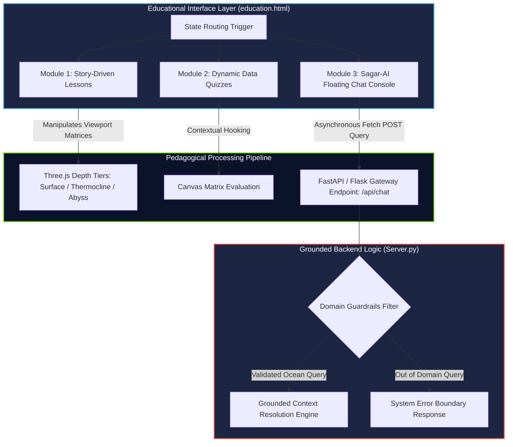

# 🎓 Education & Learning Mode Architecture
> **Sub-System Framework for Curriculum Mapping, Interactive Assessment, and Grounded Conversational Analytics**

Sagar-Drishti features a production-ready **Education Mode** engineered to bridge high-density oceanographic telemetry with intuitive public outreach pipelines. It eliminates complex spatial-temporal matrices (such as raw multi-dimensional NetCDF slicing logs) and swaps the environment into a state-driven pedagogical canvas.

---

## ⚙️ Core Architecture & Operational Mechanics

The educational portal isolates raw graphics containers and dynamically shifts the client state to serve three primary intuitive user interfaces:



---

## 🛠️ Integrated Sub-System Configurations

### 1. Sequential Oceanography Lessons (Curriculum-Mapped)
* **The Concept:** A modular storytelling layout guiding non-specialists through spatial phenomena using physical boundary data points.
* **Execution:** Standard dense numeric data grids are restricted. When an academic user initializes an instructional card (e.g., *"Understanding the Deep Ocean Thermocline Layer"*), the active script loops through predefined coordinates. It prompts the frontend **Three.js rendering viewport** to automatically run transition animations, isolating vertical depth layers (0m to 200m) with high-contrast color bands.

### 2. Context-Aware Data Quizzes (Gamified Assessment Engine)
* **The Concept:** Evaluation blocks validating whether a student can successfully parse spatial indicators, depth cross-sections, and ocean trends visually.
* **Execution:** Instead of relying on rigid, pre-compiled query text, the quiz components hook directly into active client telemetry data. The assessment module reads array entries directly out of live data streams to evaluate logical inputs:
  ```json
  {
    "quiz_id": "sagar_drishti_edu_01",
    "context_basin": "Bay of Bengal",
    "targeted_variable": "Temperature (TEMP)",
    "question": "Observing the active 3D water column gradient mesh, select the specific parameter anomaly triggering sudden cooling below 100 meters depth:",
    "options": [
      "Solar Radiation Attenuation (The Thermocline Region)",
      "Dynamic Surface Salinity Influx Vector",
      "Localized Abyssal Thermal Convection Jets"
    ],
    "correct_index": 0
  }
  ```

### 3. Sagar-AI Chatbot Pipeline (Grounded Domain Analytics)
* **The Concept:** An instant-response conversational helper container built to clarify academic terminology doubts (e.g., density variations, buoy operational fields, chlorophyll patterns) right next to the canvas.
* **Data Route & Security Mapping (`/api/chat`):**
  * Queries travel as encrypted asynchronous JSON strings straight to the unified server hub (`backend/Server.py`).
  * The ingestion script intercepts the raw incoming string, filtering inputs through strict structural regex domains to block prompt-injection anomalies.
  * System prompts hard-code structural scientific criteria bounds into response strings, eliminating conversational hallucinations and anchoring responses explicitly to INCOIS telemetry, maritime metadata, and ocean physics definitions.

---

## 📈 Operational Class Distribution & Scaling Matrix

The sub-system infrastructure scales layout densities depending on the active academic track configured by the client workspace:

| System Asset | Researcher Mode Pipeline | Education Portal Canvas |
| :--- | :--- | :--- |
| **Data Rendering Density** | High-capacity multidimensional array layers (NetCDF, GRIB matrices) | Simplified spatial vectors mapping distinct ocean cross-sections |
| **Statistical Computations** | Real-time calculation arrays tracking localized RMSE, Bias, and Variance | Streamlined narrative tooltips detailing exact observation instrument logs |
| **Traceability Trace** | Full vertical Spline coefficient logging with active processing flag markers | Descriptive plain-language labels explaining how autonomous buoys function |
| **Interactive UI Control** | Open projection mapping, manual layer configuration, data export extensions | State-driven gamified milestones matching structural academic lesson paths |
